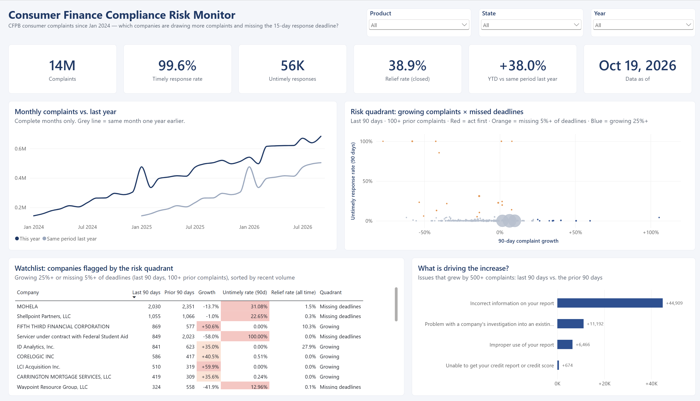

# Consumer Finance Compliance Risk Monitor

**A Power BI early-warning dashboard built on 14 million CFPB consumer complaints. It flags which financial companies are drawing more complaints and which are missing the 15-day response deadline.**



---

## The business question

Regulators, compliance teams and risk managers all face the same problem: millions of complaints arrive every year, and they can't review all of them. This dashboard answers two questions a compliance lead would ask on Monday morning:

1. **Who is drawing more complaints right now?** (90-day growth vs. the prior 90 days)
2. **Who is failing to respond on time?** (the CFPB expects a company response within 15 days)

A company that is doing *both* is the first call to make.

## Key findings (data through Oct 19, 2026)

**1. Complaint volume doubled in 2025, and 2026 has already passed it.**
2.73M complaints in 2024, 5.44M in 2025, and 5.83M in 2026 through mid-October (+38% vs. the same period last year). Credit reporting accounts for 87–91% of the volume, and one issue, *"Incorrect information on your report,"* added about 45,000 complaints in the last 90 days alone. **Caveat:** the CFPB attributes much of this surge to credit repair companies and AI tools filing duplicative complaints, so rising volume is not the same as rising consumer harm.

**2. Missed deadlines are rare overall but highly concentrated.**
Companies responded on time to 99.6% of complaints. But **student loans are 0.4% of complaints and 22% of all missed deadlines**, with about 24% answered late, compared with about 0.1% for credit reporting. Debt collection is the other hotspot (35% of all misses).

**3. Two student loan servicers account for about a third of every missed deadline.**
Of 56,459 untimely responses across all 14M complaints, **MOHELA** accounts for 10,752 (44% of its complaints answered late) and an unnamed *"Servicer under contract with Federal Student Aid"* for 7,665 (100% late). This matches the CFPB's own finding that untimely student loan responses doubled in its 2025 reporting year.

**4. The two risks don't overlap, so they need different responses.**
No company currently sits in the "act first" quadrant (growing 25%+ *and* missing 5%+ of deadlines). The fastest-growing companies (e.g., Fifth Third +50.6%, LCI Acquisition +59.9%) answer on time. The companies missing deadlines are not growing. One is a **volume problem** (dispute handling capacity); the other is a **process problem** (servicer operations).

**5. Spikes often follow enforcement news.**
Total complaints jumped 57% in January 2025. Most of that came from outside credit reporting: money transfer complaints rose about 29× in one month (1,731 → 49,743), led by Block, Inc. (Cash App). It was the same month the CFPB ordered Block to pay $175M over Cash App fraud and dispute handling. This shows correlation, not proven cause, but it suggests public enforcement actions prompt consumers to file.

## How it works

**Data:** the [CFPB Consumer Complaint Database](https://www.consumerfinance.gov/data-research/consumer-complaints/) (public CSV, 5.6 GB), filtered in Power Query to complaints received from Jan 1, 2024, onward (14,008,434 rows). Unused columns were removed and Auto date/time turned off, which took the model **from 312 MB to 12 MB**.

**Model:** a simple star schema. One fact table (`complaints`), a dedicated `Date` table marked as the model's date table, and a `_Measures` table with 27 documented measures in folders:

| Folder | Measures |
|---|---|
| Volume | Complaints, Complaint Share, Latest Complaint Date |
| Compliance | Timely / Untimely Responses, Timely Response Rate, Untimely Rate, Untimely Rate (90d), Avg Days to Forward |
| Outcomes | Closed Complaints, Relief Complaints, Relief Rate |
| Trend & Risk | YTD vs. PY, 90-day windows, 90-Day Growth %, 90-Day Change, Risk Signal, Risk Quadrant |
| Helpers | Conditional formatting colors, complete-month flag |

**Design decisions worth calling out:**
- **Like-for-like comparisons.** Prior-year and YTD measures are capped at the latest data date, so a half-finished October is never compared against a full October.
- **Consistent windows.** Both axes of the risk quadrant use the same trailing 90 days, anchored to the latest data date and unaffected by the year slicer.
- **Noise control.** Companies need 100+ complaints in the prior 90 days to be flagged, so a jump from 2 to 4 complaints doesn't read as "+100%."
- **Complete months only** on the trend line, to avoid a false drop at the end of the chart.
- **Color carries meaning.** Navy for data, red and orange reserved for risk, with bubble and cell colors driven by measures, not hard-coded.

## Repository structure

```
Project 2.pbip                  ← open this in Power BI Desktop
Project 2.SemanticModel/        ← data model as code (TMDL)
  definition/tables/_Measures.tmdl   ← every measure, with descriptions
  definition/tables/Date.tmdl
  definition/tables/complaints.tmdl  ← Power Query load + filter steps
Project 2.Report/               ← report pages and visuals (PBIR JSON) + theme
analysis/findings.dax           ← DAX queries used to verify every finding above
images/                         ← screenshots
```

The project is saved in Power BI's **PBIP format**, so the model and report are stored as readable text files instead of a single binary .pbix. Every measure can be reviewed here on GitHub.

## Run it yourself

1. Download the complaint data (CSV ZIP) from the [CFPB site](https://www.consumerfinance.gov/data-research/consumer-complaints/) and unzip it.
2. Open `Project 2.pbip` in Power BI Desktop.
3. Transform data → update the file path in the `complaints` query to your CSV → Close & Apply.

The raw data isn't included in this repo (5.6 GB).

## Limitations

- The public database only includes complaints the CFPB publishes. The CFPB reported about 6.6M complaints *received* in 2025, compared with 5.44M published here.
- Complaint counts reflect what consumers *file*, not verified wrongdoing. The CFPB has flagged duplicate and third-party filings, especially in credit reporting.
- "Untimely" is the company's response timing as recorded by the CFPB. It doesn't measure the quality of the response.
- The CFPB changed parts of its complaint process in 2026 (e.g., requiring consumers to dispute with credit bureaus first), which may affect trends going forward.

## Tools

Power BI Desktop · Power Query (M) · DAX · TMDL / PBIR (Power BI Project format) · Git

---

*Built by Mohammad (Mo) Alazawi, MS in Business Analytics.*
